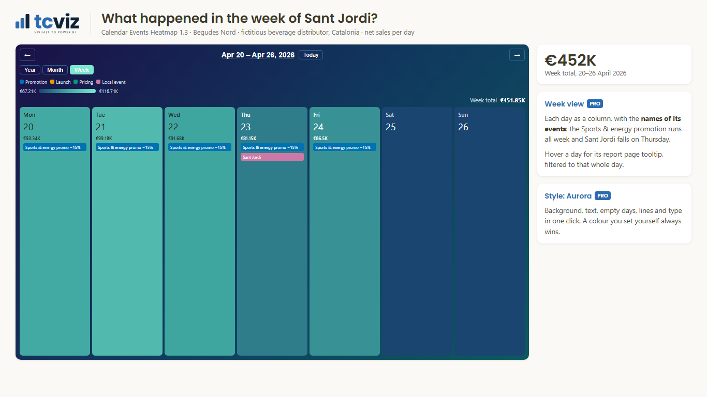
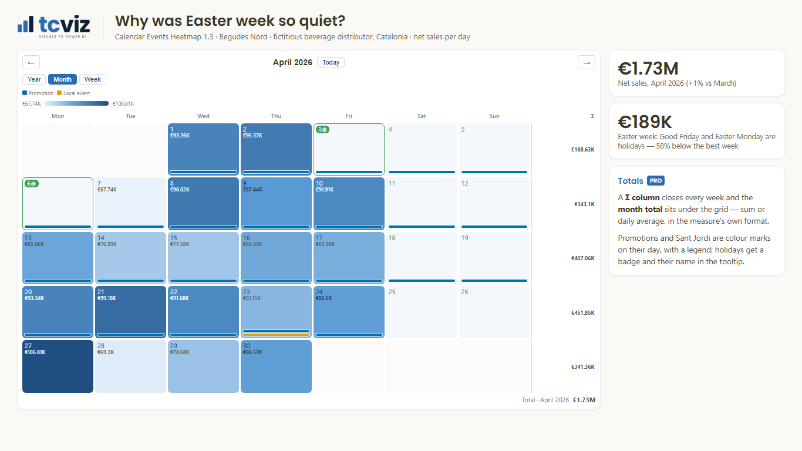
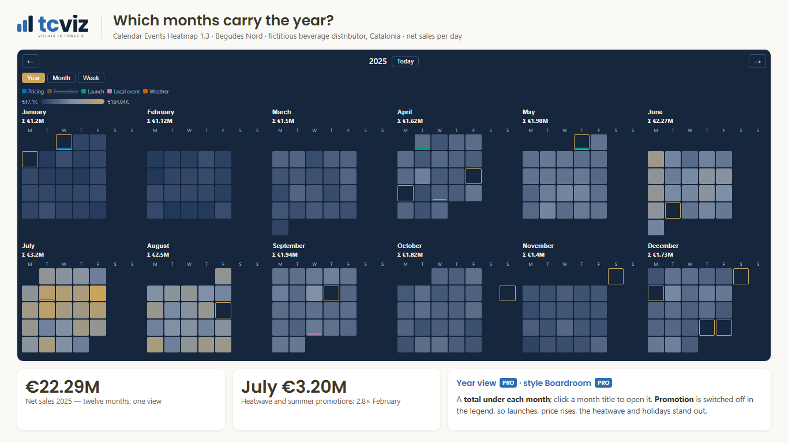

# Calendar Events Heatmap

> **1.3.0.0:** week and month totals and six collection styles (Pro), the Report theme style and an Accessibility card (free), text that scales with the visual, and report tooltip pages filtered to the whole day with every event. **1.2.1.2:** the TCViz start screen and a Try Pro row in the setup guide. **1.2.0.0:** year, month and week views with drill up and down, date-range filtering, fiscal calendars in months or 4-4-5 weeks, color rules, 10 color schemes, 5 style templates, a setup guide, format on the canvas and 12 languages. See the [changelog](https://tinocallarisa-web.github.io/calendar/changelog.html).

**A Power BI custom visual by [TCViz](https://github.com/tinocallarisa-web).**
Daily KPI intensity and dated business events on one calendar surface — promotions,
campaigns and holidays shown alongside the measure they moved.

**[Get it on Microsoft Marketplace](https://marketplace.microsoft.com/en-us/product/power-bi-visuals/tino_callarisa.calendar-events-heatmap)** — free tier, no licence required.

[Product page](https://tcviz.com/product/calendar-events-heatmap/) ·
[Documentation](https://tinocallarisa-web.github.io/calendar/support.html) ·
[Changelog](https://tinocallarisa-web.github.io/calendar/changelog.html) ·
[Video tutorial](https://www.youtube.com/watch?v=CJ62plGb6QE) ·
[Report an issue](https://github.com/tinocallarisa-web/calendar/issues) ·
[Questions & ideas](https://github.com/tinocallarisa-web/calendar/discussions)



---

## The problem it solves

Power BI can show a daily measure, and it can list your promotions and holidays. Doing
both at once normally means two visuals and a mental join — read the spike in one, then
hunt for what was running that week in the other.

This visual puts them in the same cell. Each day is shaded by your measure and carries
colour marks for whatever was happening on it, so the question *"what happened on the days
performance changed?"* is answered by looking, not by cross-referencing.

Typical uses: retail promotion tracking, marketing campaign calendars, staffing and
attendance overviews, service and maintenance planning, holiday impact analysis.

---

## Quick start

1. Drop the visual on the page and connect a **Date** column and a **Main Measure**.
2. Optionally add **Event Name** and **Event Category** to get colour marks, and
   **Holiday Name** to mark holidays. The setup guide inside the visual ticks off each field.
3. Pick a style under **Format → Style template** — Report theme, five free templates or
   six collection styles (Pro) — and tune **Heatmap Colors** and **Events**.

> **Date hierarchies.** The automatic date hierarchy works: the visual rebuilds each date
> from Year, Quarter, Month and Day. Keep the **Day** level in the well — without it the
> visual says so instead of piling the data on one day.

There are sample CSVs in this repo — [`sample_sales.csv`](sample_sales.csv),
[`sample_events.csv`](sample_events.csv) and [`sample_holidays.csv`](sample_holidays.csv)
— if you want to try it before wiring up your own model.

---

## Field wells

| Field well | Kind | What it does |
|---|---|---|
| **Date** | Grouping | The calendar date: a date column, or the date hierarchy with its Day level. |
| **Main Measure** | Measure | Drives the heatmap shading and the value printed in each day. |
| **Tooltip Measures** | Measure | Extra measures shown in the tooltip; with Pro, any of them can colour the calendar. |
| **Event Name** | Grouping | The event on that day. |
| **Event Category** | Grouping | Groups events for colour coding, and drives the legend. |
| **Holiday Name** | Grouping | Marks the day as a holiday. The date comes from the Date field. |

---

## What it does

**Calendar** — year, month and week views with drill up and down and a Today button, one
to twelve months side by side, ISO or US week numbers, configurable week start, and fiscal
calendars by month or in 4-4-5, 4-5-4 and 5-4-4 weeks.

**Totals (Pro, 1.3)** — a Σ column for each week row and the month total under the grid; the
total under each month in the year view and the week total in the week view. Sum or daily
average, in the measure's own number format.

**Styles** — Report theme (the heat scale and text take your report theme's colours) and the
Classic, Clean, Tiles, Minimal and TCViz templates, free; six collection styles shared with the
other TCViz visuals — Boardroom, Ledger, Editorial, Signal, Aurora and Terrace — with Pro.

**Heatmap** — gradient from your min to max colour across the visible range, with a
separate colour for days that have no data, so an empty day never reads as a low one.

**Events** — colour marks stacked at the bottom of the day (or labels in the week view), one
colour per category from five distinct palettes, with an in-visual legend. Click a category in
the legend to hide its marks: the day values do not change. Free shows one event per day with a
`+N` counter; Pro shows several. Sales and events in two tables related by date are counted once
per day (*Heatmap Colors → Rows of the same day*).

**Report integration** — standard tooltips and report tooltip pages (filtered to the whole
day, with every event of that day), cross-page filtering with multi-select and date ranges,
bookmarks, color rules on the day's value, and the measure's own format string honoured
throughout, including dynamic format strings.





---

## Accessibility

The calendar is a real grid, not a picture of one.

- **Keyboard.** `Tab` enters the grid once; arrows move by day and week, `Home`/`End`
  jump to the ends of the week, `Page Up`/`Page Down` change month or week, `Enter` or
  `Space` filters the report, `Ctrl`+`Enter` adds to the selection, `Esc` clears it and
  `Shift`+`F10` opens the Power BI context menu. Moving past the edge navigates and
  keeps focus on the day you moved to.
- **Screen readers.** Every day announces its full date, the measure value, the holiday
  name and the events on it.
- **High contrast.** Under a Windows high-contrast theme the visual stops using fill
  colour to carry meaning: the heatmap intensity becomes border weight, badges and
  legend swatches switch to an outlined style, and everything takes the theme's own
  foreground and background. *Format → Accessibility → High contrast = On* gives the same
  rendering without changing the Windows theme.
- **Accessibility card.** Focus outline colour and width, and a minimum text size: text
  shrinks with a small visual instead of overflowing, but never below that size.

---

## Free and Pro

Everything below works without a licence: the full month calendar with the KPI heatmap,
colour schemes, color rules, the Report theme style and five templates, events (one per day
with a `+N` counter) in five palettes, holidays, tooltip measures and report tooltip pages,
date-range filtering, fiscal calendars including 4-4-5, week numbers, bookmarks, the setup
guide, the Accessibility card, keyboard navigation and high contrast.

**Pro** adds the year and week views, one to twelve months side by side, week and month
totals, the six collection styles, measure switching, several events per day, and your own
colours for each event category, the measure labels and the view buttons. While you edit
without a licence, each Pro feature you turn on is drawn working under a "Pro preview"
watermark. Pro comes with a 30-day free trial on AppSource.

---

## Documentation and support

- **[Product page](https://tcviz.com/product/calendar-events-heatmap/)** — features, pricing and screenshots.
- **[Marketplace listing](https://marketplace.microsoft.com/en-us/product/power-bi-visuals/tino_callarisa.calendar-events-heatmap)** — install it, download the sample report, or
  start the 30-day Pro trial.
- **[Full documentation](https://tinocallarisa-web.github.io/calendar/support.html)** —
  quick start, field wells, complete format pane reference, report integration,
  accessibility and FAQ, with search.
- **[Changelog](https://tinocallarisa-web.github.io/calendar/changelog.html)** — what
  changed in every release.
- **[Video tutorial](https://www.youtube.com/watch?v=CJ62plGb6QE)** — the visual set up
  end to end.
- **[Issues](https://github.com/tinocallarisa-web/calendar/issues)** — bug reports and
  feature requests. Please use the templates; they ask for the version and environment
  details that make a report actionable.
- **[Discussions](https://github.com/tinocallarisa-web/calendar/discussions)** —
  questions, ideas and setup help.
- **Licence and billing** — <support@tcviz.com>.

---

## Privacy

The visual makes no network calls. It reads only the data you connect to its field
wells, and its settings are stored in your report file. Licence validation goes through
Power BI's own licensing API, not a server of ours. Full detail in the
[privacy policy](https://tinocallarisa-web.github.io/calendar/privacy.html) and the
[terms of use](https://tinocallarisa-web.github.io/calendar/terms.html).

---

## Building from source

```bash
npm install
npx pbiviz package        # production build → dist/
node build-test.js        # test build with Pro unlocked, GUID suffixed _test
node tools/build-changelog.js   # regenerate changelog.html from CHANGELOG.md
```

Requires the [Power BI Visuals Tools](https://www.npmjs.com/package/powerbi-visuals-tools).
The `certification` branch mirrors what is published to AppSource.
